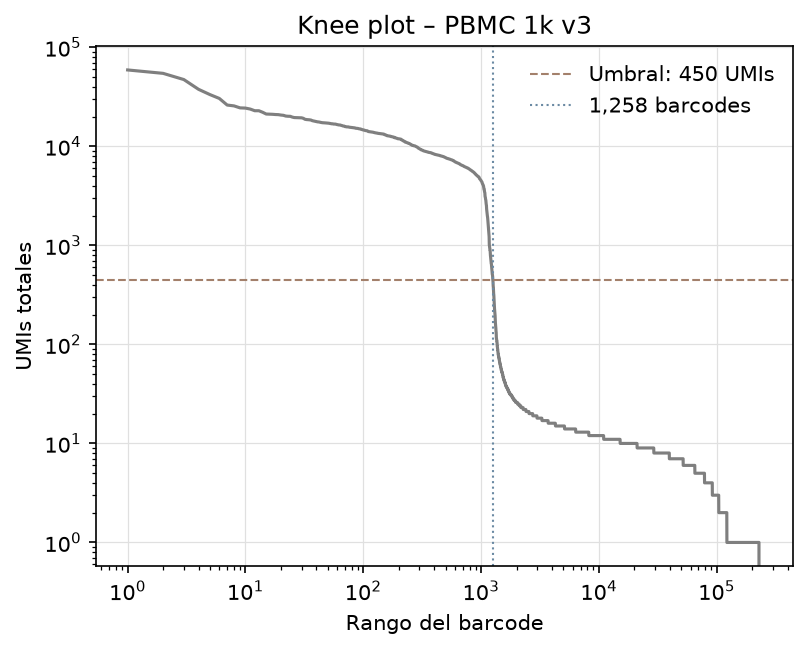
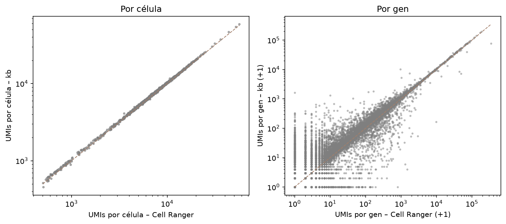

# scRNA-seq desde cero: de FASTQ a matriz de conteos

Procesamiento de datos crudos de single-cell RNA-seq (10x Genomics 3' v3) con kallisto | bustools. El proyecto empieza con los archivos FASTQ, genera una matriz de conteos, filtra las células y compara el resultado con el de Cell Ranger, el programa oficial de 10x.

## Resumen

- **Datos:** 1k PBMCs de un donador sano (10x Genomics), 66.6 millones de lecturas.
- **Pasos:** pseudoalineamiento con kb-python (índice de Ensembl 108) → matriz sin filtrar → filtrado de células con knee plot → comparación con Cell Ranger 3.0.0.
- **Resultados:**
  - 57.4% de las lecturas se asignaron a un transcrito (Cell Ranger: 53.7%).
  - Se retuvieron 1,258 células de 241,214 barcodes (umbral de 450 UMIs).
  - Se encontraron las 1,222 células que reporta Cell Ranger (100%).
  - Correlación con Cell Ranger: r = 1.000 en UMIs por célula y r = 0.963 en conteos por gen.

## Estructura del repositorio

```
envs/environment.yml                         Ambiente de conda
scripts/01_referencia.sh                     Descarga del índice de kallisto y la tabla t2g
scripts/02_kb_count.sh                       Cuantificación con kb count
notebooks/01_knee_plot.ipynb                 Knee plot y filtrado de células
notebooks/02_comparacion_cellranger.ipynb    Comparación con Cell Ranger
results/figures/                             Figuras
data/                                        Datos (no se incluyen en el repositorio)
```

## Cómo reproducirlo

```bash
# 1. Crear y activar el ambiente
mamba env create -f envs/environment.yml
conda activate scrna-fastq

# 2. Descargar los datos de 10x en data/raw/ y extraer los FASTQ
mkdir -p data/raw
cd data/raw
BASE=https://cf.10xgenomics.com/samples/cell-exp/3.0.0/pbmc_1k_v3
wget -c $BASE/pbmc_1k_v3_fastqs.tar
wget -c $BASE/pbmc_1k_v3_filtered_feature_bc_matrix.h5
wget -c $BASE/pbmc_1k_v3_web_summary.html
tar -xvf pbmc_1k_v3_fastqs.tar
cd ../..

# 3. Descargar la referencia
bash scripts/01_referencia.sh

# 4. Generar la matriz de conteos
bash scripts/02_kb_count.sh

# 5. Correr los notebooks en orden (01 y 02)
```

**Requisitos:** ~16 GB de RAM y ~20 GB de disco.

## 1. Estructura de los datos

### Dataset

- **Fuente:** [10x Genomics, dataset público "1k PBMCs from a Healthy Donor (v3 chemistry)"](https://www.10xgenomics.com/datasets/1-k-pbm-cs-from-a-healthy-donor-v-3-chemistry-3-standard-3-0-0)
- **Muestra:** células mononucleares de sangre periférica (PBMC) de un donador sano. Cell Ranger estimó 1,222 células.
- **Química:** Chromium Single Cell 3' v3. La matriz original se generó con Cell Ranger 3.0.0.
- **Secuenciador:** Illumina NovaSeq 6000.

### Archivos FASTQ

| Archivo | Lectura | Longitud (pb) | Contenido |
|---|---|---|---|
| `..._L001_I1_001.fastq.gz` | I1 | 8 | Índice de muestra: identifica la biblioteca cuando se secuencian varias muestras en la misma corrida |
| `..._L001_R1_001.fastq.gz` | R1 | 28 | Cell barcode (16 pb) + UMI (12 pb) |
| `..._L001_R2_001.fastq.gz` | R2 | 91 | Secuencia del cDNA (el transcrito) |

**Nombre de los archivos** (`pbmc_1k_v3_S1_L001_R1_001.fastq.gz`):

- `S1`: número de muestra en la corrida.
- `L001` / `L002`: carril (*lane*) de la celda de flujo. La misma biblioteca se secuenció en dos carriles; los dos se juntan al cuantificar.
- `R1` / `R2`: lectura 1 y lectura 2 del mismo fragmento. En 10x tienen contenido distinto: R1 contiene el barcode y el UMI, y R2 contiene el cDNA.
- `I1`: lectura del índice de muestra.
- `001`: número de parte del archivo.

### Formato de una lectura FASTQ

```
@A00228:279:HFWFVDMXX:1:1101:8486:1000 2:N:0:NCATTACT
NACAAAGTCCCCCCCATAATACAGGGGGAGCCACTTGGGCAGGAGGCAGGGAGGGGTCCATTCCCCCTGGTGGGGCTGGTGGGGAGCTGTA
+
#FFFFFFFFFFFFFFF:FFFFFFF:FFFFFFFFFFFFFFFFFFFFFFFFFF:FFFFFFFFFFFFFFFF:FFFFFFFFFFFFFFFFFFFFFF
```

Cada lectura ocupa 4 líneas:

1. **Identificador:** empieza con `@`. Contiene datos de la corrida y la posición de la lectura en la celda de flujo.
2. **Secuencia:** las bases leídas. En R2 es cDNA, en R1 es barcode + UMI y en I1 es el índice. `N` es una base que no se pudo leer.
3. **Separador:** `+`.
4. **Calidad:** un carácter por base, en formato Phred+33. La calidad es `Q = código ASCII − 33`, y la probabilidad de error es `10^(−Q/10)`. Ejemplos: `F` = Q37 (~1 error en 5,000 bases), `:` = Q25 y `#` = Q2. La NovaSeq agrupa las calidades en pocos valores, por eso solo aparecen unos cuantos caracteres.

**Campos del identificador:**

```
@A00228:279:HFWFVDMXX:1:1101:8486:1000 1:N:0:NCATTACT
```

| Campo | Valor | Significado |
|---|---|---|
| Equipo | `A00228` | Número de serie del secuenciador (`A` = NovaSeq) |
| Corrida | `279` | Número de corrida en ese equipo |
| Flowcell | `HFWFVDMXX` | ID de la celda de flujo |
| Carril | `1` | Carril de la celda de flujo |
| Tile : x : y | `1101:8486:1000` | Sección (*tile*) y coordenadas de la lectura en la celda de flujo |
| Lectura | `1` | Número de lectura (`1` en R1, `2` en R2) |
| Filtrada | `N` | `N` = pasó el filtro de calidad; `Y` = no pasó |
| Control | `0` | `0` = no es una lectura de control |
| Índice | `NCATTACT` | Secuencia del índice de muestra (la misma que en I1) |

El identificador es igual en R1, R2 e I1: las tres lecturas vienen del mismo fragmento de DNA.

### Estructura del oligo de captura (10x 3' v3)

```
Perla ── [Read 1 primer] ── [Cell barcode 16 pb] ── [UMI 12 pb] ── [poly(dT) ~30 nt]
                             igual en toda la perla   distinto en cada oligo   se une a la cola poli-A del mRNA

Biblioteca final:
P5 ─ Read 1 ─ Barcode ─ UMI ─ poly(dT) ─ cDNA ─ Read 2 primer ─ índice i7 ─ P7
      └─ R1: 28 pb ──┘                    └─ R2: 91 pb          └─ I1: 8 pb
```

**Ejemplo con una lectura real de R1:**

```
NGTGATTAGCTGTACT | CGTATGTAAGGT
 barcode (16 pb) |  UMI (12 pb)
```

- **Cell barcode (16 pb):** identifica la célula. Cada perla tiene un barcode distinto y entra en una gota con, idealmente, una sola célula. Por eso todas las moléculas capturadas en una gota tienen el mismo barcode.
- **UMI (12 pb):** identifica cada molécula de mRNA capturada. La PCR genera varias copias de cada molécula; las lecturas con el mismo barcode, el mismo UMI y el mismo gen se cuentan como una sola molécula.
- **poly(dT):** se une a la cola poli-A del mRNA, que está en el extremo 3'. Por eso las lecturas se concentran cerca del extremo 3' de cada gen.

### Conteo de lecturas

| Carril | Lecturas R1 | Lecturas R2 | Lecturas I1 |
|---|---|---|---|
| L001 | 33,436,697 | 33,436,697 | 33,436,697 |
| L002 | 33,165,190 | 33,165,190 | 33,165,190 |
| **Total** | **66,601,887** | **66,601,887** | **66,601,887** |

- R1, R2 e I1 tienen el mismo número de lecturas porque las tres se leen de cada fragmento.
- **Lecturas por célula:** 66,601,887 / 1,222 células = 54,502 (el web summary de 10x reporta 54,502).

### Comandos utilizados

```bash
# Ver el contenido del .tar sin extraerlo
tar -tvf pbmc_1k_v3_fastqs.tar

# Extraer los FASTQ
tar -xvf pbmc_1k_v3_fastqs.tar

# Ver las primeras 2 lecturas (8 líneas) de cada archivo sin descomprimir
zcat pbmc_1k_v3_S1_L001_I1_001.fastq.gz | head -8
zcat pbmc_1k_v3_S1_L001_R1_001.fastq.gz | head -8
zcat pbmc_1k_v3_S1_L001_R2_001.fastq.gz | head -8

# Longitud de las primeras 100 lecturas (línea 2 de cada bloque de 4)
zcat pbmc_1k_v3_S1_L001_R1_001.fastq.gz | head -400 | awk 'NR % 4 == 2 {print length($0)}' | sort | uniq -c

# Contar líneas; lecturas = líneas / 4
zcat pbmc_1k_v3_S1_L001_R1_001.fastq.gz | wc -l
```

## 2. Referencia

### Índice utilizado

- **Fuente:** índice de kallisto ya construido, descargado con `kb ref -d human` ([pachterlab/kallisto-transcriptome-indices](https://github.com/pachterlab/kallisto-transcriptome-indices)).
- **Versión:** Ensembl 108, genoma GRCh38. Construido con kb-python 0.28.
- **Tipo:** *standard*. Solo contiene transcritos maduros (mRNA sin intrones). Incluye genes que codifican proteínas, lncRNA y genes de inmunoglobulinas y de receptores de células T (IG/TR). Existe otro tipo, *nac*, que también incluye intrones y se usa para single-nucleus o RNA velocity.
- **Tamaño:** índice de 393 MB y t2g de 17 MB.

**Limitación:** como el índice no incluye intrones, las lecturas que vienen de pre-mRNA (RNA que todavía tiene intrones) no se cuantifican (ver sección 3).

### Cómo funciona el pseudoalineamiento

- **Alinear** (STAR, Cell Ranger): busca la posición exacta de cada lectura en el genoma, base por base.
- **Pseudoalinear** (kallisto): no busca la posición. Solo determina con qué transcritos es compatible cada lectura. Es más rápido y usa mucha menos memoria.

kallisto divide cada transcrito de la referencia en fragmentos de 31 bases (**k-mers**, k = 31) y guarda en el índice en qué transcritos aparece cada k-mer. Después divide cada lectura en sus k-mers y busca los transcritos que contienen todos esos k-mers. Ese conjunto de transcritos se llama **clase de equivalencia**.

Al pseudoalinear no se obtiene la posición exacta de la lectura, así que no se pueden detectar mutaciones ni transcritos que no estén en la referencia.

### Tabla transcrito → gen (t2g)

```
ENST00000343575.11  ENSG00000107562.17  CXCL12  CXCL12-201  10  44377067  44385097  -
ENST00000374426.6   ENSG00000107562.17  CXCL12  CXCL12-202  10  44375867  44385043  -
ENST00000374429.6   ENSG00000107562.17  CXCL12  CXCL12-203  10  44370165  44385092  -
```

| Columna | Contenido |
|---|---|
| 1 | ID de Ensembl del transcrito (`ENST…`; el número después del punto es la versión) |
| 2 | ID de Ensembl del gen (`ENSG…`) |
| 3 | Nombre del gen |
| 4 | Nombre del transcrito (isoforma) |
| 5 | Cromosoma |
| 6 | Posición de inicio |
| 7 | Posición de fin |
| 8 | Hebra (`+` / `-`) |

- **Transcritos:** 227,665
- **Genes:** 39,546
- **Transcritos por gen (promedio):** ~5.8
- **Ejemplo:** CXCL12 tiene 8 isoformas (CXCL12-201 a CXCL12-208), todas del gen `ENSG00000107562`.

El índice trabaja con transcritos, pero la matriz cuenta genes. La tabla t2g indica a qué gen pertenece cada transcrito:

- Si una lectura es compatible con varias isoformas de CXCL12, se cuenta para CXCL12.
- Si una lectura es compatible con transcritos de genes distintos, no se puede saber de qué gen viene y se descarta.

### Comandos utilizados

```bash
# Descargar el índice y el t2g (ver scripts/01_referencia.sh)
bash scripts/01_referencia.sh

# Tamaño de los archivos
ls -lh data/reference/

# Primeras líneas del t2g
head data/reference/t2g.txt

# Número de transcritos (una línea por transcrito)
wc -l data/reference/t2g.txt

# Número de genes distintos (valores únicos de la columna 2)
cut -f2 data/reference/t2g.txt | sort -u | wc -l

# Isoformas de un gen
grep -w CXCL12 data/reference/t2g.txt
```

## 3. Cuantificación con kb count

### Comando

```bash
bash scripts/02_kb_count.sh
```

El script usa los FASTQ de los dos carriles, el índice de kallisto y el t2g, y genera una matriz de conteos **barcodes × genes sin filtrar**. Cada fila es un barcode y cada columna es un gen.

- Los FASTQ se pasan en pares por carril (primero R1, luego R2), porque kb lee el barcode y el UMI del primer archivo y el cDNA del segundo.
- I1 no se usa: solo sirve para separar muestras dentro de una corrida, y estos FASTQ ya contienen una sola muestra.

### Pasos internos de kb count

| Paso | Herramienta | Qué hace |
|---|---|---|
| 1 | `kallisto bus` | Pseudoalinea cada R2 y guarda, por lectura, su barcode, su UMI y su clase de equivalencia en un archivo BUS (*Barcode, UMI, Set*). |
| 2 | `bustools correct` | Compara cada barcode con la lista de barcodes válidos de 10x v3 y corrige los que tienen una base distinta (errores de secuenciación). |
| 3 | `bustools sort` | Ordena los registros por barcode y UMI, para que las lecturas de la misma molécula queden juntas. |
| 4 | `bustools count` | Junta las lecturas con el mismo barcode y UMI en una sola molécula (quita los duplicados de PCR) y usa el t2g para asignar cada molécula a un gen. Genera la matriz. |

**Posición de cada elemento en 10x v3** (`kb --list`):

| Elemento | Archivo | Posición |
|---|---|---|
| Cell barcode | R1 (archivo 0) | bases 0–16 |
| UMI | R1 (archivo 0) | bases 16–28 |
| cDNA | R2 (archivo 1) | completa |

### Archivos de salida

| Archivo | Contenido |
|---|---|
| `output.bus` / `output.unfiltered.bus` | Registros de barcode, UMI y clase de equivalencia antes de contar. Son archivos intermedios y se pueden borrar. |
| `matrix.ec` | Lista de clases de equivalencia: qué transcritos forman cada clase. |
| `transcripts.txt` | Lista de los transcritos del índice, en el orden que usa `matrix.ec`. |
| `run_info.json` | Resumen del pseudoalineamiento: lecturas procesadas y porcentaje pseudoalineado. |
| `inspect.json` | Resumen de barcodes y UMIs: cuántos hay, cuántos son válidos y medianas por barcode. |
| `counts_unfiltered/cells_x_genes.mtx` | Matriz de conteos en formato disperso (Matrix Market): solo guarda los valores distintos de cero. |
| `counts_unfiltered/cells_x_genes.barcodes.txt` | Barcodes, uno por fila de la matriz. |
| `counts_unfiltered/cells_x_genes.genes.txt` / `.genes.names.txt` | Genes (IDs de Ensembl y nombres), uno por columna de la matriz. |
| `counts_unfiltered/adata.h5ad` | La misma matriz en formato AnnData, para Scanpy. |

### Pseudoalineamiento (`run_info.json`)

| Métrica | kb (kallisto) | Cell Ranger 3.0.0 |
|---|---|---|
| Lecturas procesadas | 66,601,887 | 66,601,887 |
| Pseudoalineadas / mapeadas al transcriptoma | 38,261,433 (57.4%) | 53.7% |
| Compatibles con un solo transcrito | 14.7% | — |
| Mapeadas a intrones | — (el índice no tiene intrones) | 31.1% |
| Mapeadas entre genes | — | 4.8% |

- **~43% de las lecturas no pseudoalinean.** Según Cell Ranger, el 31.1% de las lecturas cae en intrones y el 4.8% entre genes. El índice solo tiene transcritos maduros, así que esas lecturas no tienen un transcrito compatible. El porcentaje es parecido al de Cell Ranger, así que no indica un problema.
- **Solo el 14.7% es compatible con un único transcrito.** La mayoría de las lecturas cae en exones que comparten varias isoformas del mismo gen. Con el t2g, esas lecturas se asignan a su gen sin problema.

### Barcodes y UMIs (`inspect.json`)

| Métrica | Valor |
|---|---|
| Barcodes distintos (antes de corregir) | 504,233 |
| Barcodes en la lista válida | 230,319 (45.7%) |
| Lecturas con barcode en la lista válida | 95.8% (Cell Ranger: 97.4%) |
| Mediana de lecturas por barcode | 3 |
| Mediana de UMIs por barcode | 1 |
| Barcodes en la matriz sin filtrar | 241,214 |
| Células estimadas por Cell Ranger | 1,222 |
| Mediana de UMIs por célula (Cell Ranger) | 6,628 |

- **Solo el 45.7% de los barcodes son válidos, pero tienen el 95.8% de las lecturas.** Los barcodes no válidos son sobre todo errores de secuenciación: una base mal leída produce un barcode que no existe en la lista. Cada uno tiene muy pocas lecturas.
- **La mediana es de 1 UMI por barcode.** La mayoría de los barcodes viene de **gotas vacías**: gotas con perla pero sin célula. Estas gotas capturan un poco de **RNA ambiental**, es decir, RNA suelto en la suspensión que viene de células rotas.

### Conclusión

Se procesaron las 66.6 millones de lecturas. El porcentaje de lecturas pseudoalineadas (57.4%) y de lecturas con barcode válido (95.8%) es parecido al de Cell Ranger. La diferencia principal son las lecturas de intrones, que el índice *standard* no incluye. La matriz tiene 241,214 barcodes, la mayoría de gotas vacías; el siguiente paso es separar las células.

## 4. Filtrado de células: knee plot

Notebook: `notebooks/01_knee_plot.ipynb`

### Problema

La matriz sin filtrar tiene 241,214 barcodes, pero el experimento tiene alrededor de 1,200 células. Hay que decidir qué barcodes son células y cuáles son gotas vacías.

### Método

1. Se sumaron los UMIs de cada barcode (suma de cada fila de la matriz).
2. Se ordenaron los barcodes de mayor a menor número de UMIs y se graficaron contra su posición en esa lista (rango), con los dos ejes en escala logarítmica. Esta gráfica se llama *knee plot*.
3. Se eligió un umbral de UMIs en la zona donde la curva cae de forma brusca. Los barcodes por encima del umbral son células (muchos UMIs) y los de abajo son gotas vacías (pocos UMIs).

Se usa escala logarítmica porque los valores van de 1 a ~59,000 UMIs y de 1 a ~241,000 barcodes.



La gráfica tiene tres zonas:

- **Parte alta** (rango 1 a ~1,000): células, con miles a decenas de miles de UMIs.
- **Caída brusca** (rango ~1,150 a ~1,350): transición entre células y gotas vacías.
- **Parte baja** (rango > 1,500): gotas vacías, con 1 a ~50 UMIs.

### Elección del umbral

| Rango del barcode | UMIs totales |
|---|---|
| 1,000 | 4,502 |
| 1,150 | 1,612 |
| 1,200 | 805 |
| 1,222 | 661 |
| 1,300 | 230 |
| 1,350 | 116 |
| 1,500 | 53 |

| Umbral (UMIs) | Barcodes retenidos |
|---|---|
| ≥ 100 | 1,369 |
| ≥ 200 | 1,315 |
| **≥ 450** | **1,258** |
| ≥ 500 | 1,251 |
| ≥ 1,000 | 1,177 |
| ≥ 2,000 | 1,131 |

**Umbral elegido: 450 UMIs.** Está en la parte más vertical de la caída. Entre los rangos 1,150 y 1,350, los UMIs bajan de ~1,600 a 116. Por eso cualquier umbral entre 200 y 1,000 retiene entre 1,177 y 1,315 barcodes: el número de células cambia poco con el valor exacto del umbral.

**Limitación:** un umbral único de UMIs es una simplificación. Los barcodes de la zona de caída pueden ser células pequeñas o dañadas, o gotas vacías con mucho RNA ambiental. Cell Ranger usa otro método, EmptyDrops (ver sección 5).

### Resultado

| | Valor |
|---|---|
| Barcodes antes del filtro | 241,214 |
| Células retenidas | 1,258 |
| Barcodes eliminados | 239,956 (99.5%) |
| Células estimadas por Cell Ranger 3.0.0 | 1,222 |
| Diferencia | +36 (+2.9%) |

La matriz filtrada se guardó en `data/processed/pbmc_1k_v3/adata_filtered.h5ad`.

## 5. Comparación con Cell Ranger

Notebook: `notebooks/02_comparacion_cellranger.ipynb`

Se comparó la matriz filtrada de este proyecto (kb, 1,258 células) con la matriz filtrada que publica 10x (Cell Ranger 3.0.0, 1,222 células).

### Formato de los identificadores

Las dos matrices escriben los barcodes y los genes de forma distinta. Antes de comparar se usó el mismo formato:

| | kb | Cell Ranger | Cambio |
|---|---|---|---|
| Barcodes | `AAACCCAAGGAGAGTA` | `AAACCCAAGGAGAGTA-1` | Quitar el `-1` de Cell Ranger |
| Genes | `ENSG00000243485.5` | `ENSG00000243485` | Quitar la versión del ID de Ensembl |

Los genes se comparan por ID de Ensembl y no por nombre, porque algunos genes distintos tienen el mismo nombre.

### Células

| | Barcodes |
|---|---|
| En común | 1,222 |
| Solo kb | 36 |
| Solo Cell Ranger | 0 |

**Se encontraron todas las células de Cell Ranger (100%).**

| | n | Mediana de UMIs | Mínimo | Máximo |
|---|---|---|---|---|
| También en Cell Ranger | 1,222 | 6,918 | 456 | 59,111 |
| Solo kb | 36 | 562 | 452 | 2,615 |

La mayoría de los 36 barcodes extra tiene pocos UMIs (zona de caída del knee plot). Pero Cell Ranger descartó barcodes de hasta 2,615 UMIs y conservó uno de 456. Esto pasa porque Cell Ranger no usa un umbral de UMIs: usa **EmptyDrops**, un método que compara los genes que expresa cada barcode con los del RNA ambiental y descarta los barcodes que se parecen al RNA ambiental.

### Genes

| | Genes |
|---|---|
| En común | 33,055 |
| Solo kb (Ensembl 108) | 6,491 |
| Solo Cell Ranger (Ensembl 93) | 483 |

Las diferencias vienen de los cambios entre Ensembl 93 y 108 (genes nuevos, eliminados o unidos) y de los tipos de gen que incluye cada referencia.

### Conteos



| Nivel | Métrica | Valor |
|---|---|---|
| Por célula | Pearson (UMIs totales) | 1.000 |
| Por gen | Pearson (log1p de UMIs totales) | 0.963 |
| Por gen | Spearman | 0.933 |

- **Por célula:** los UMIs totales son prácticamente iguales. kb cuenta ~2.7% más UMIs por célula (mediana).
- **Por gen:** la mayoría de los genes está sobre la diagonal. Para Pearson se usó `log1p` (logaritmo de 1 + x), porque los conteos van de 0 a cientos de miles y sin el logaritmo unos pocos genes muy expresados dominarían la correlación. Spearman compara el orden de los genes, así que no necesita logaritmo.

### Genes con diferencias

**Columnas y filas de puntos en la gráfica por gen:** los conteos son números enteros. En escala logarítmica, los valores bajos (0, 1, 2…) quedan separados, y los genes con el mismo conteo forman columnas o filas. 3,159 genes tienen 0 UMIs en Cell Ranger y algunos en kb, y 455 genes al revés. Casi todos tienen menos de 10 UMIs en total, y con conteos tan bajos cualquier diferencia entre métodos se ve grande.

**Genes con diferencias grandes:**

| Gen | kb | Cell Ranger | Explicación probable |
|---|---|---|---|
| MALAT1 | 77,259 | 347,234 | lncRNA nuclear muy abundante; muchas de sus lecturas no vienen de la cola poli-A y cada programa las asigna de forma distinta |
| PYURF | 0 | 802 | Comparte su mRNA con el gen PIGY; kallisto descarta las lecturas compatibles con dos genes |
| XACT, KLF15, LINC01206 | cientos a miles | 0 | Cambios de anotación entre Ensembl 93 y 108 |
| NPIPB13 | 648 | 3 | Pertenece a una familia de genes casi idénticos; las lecturas que coinciden con varios se reparten de forma distinta |
| MT-ND6 | 10,119 | 962 | Gen mitocondrial que se sobrepone con otros genes; cada programa resuelve la sobreposición de forma distinta |

### Conclusión

Este proyecto usó un método distinto al de Cell Ranger (pseudoalineamiento en lugar de alineamiento, Ensembl 108 en lugar de 93 y umbral de UMIs en lugar de EmptyDrops). Aun así, encontró todas las células de Cell Ranger, con UMIs por célula prácticamente iguales (r = 1.000) y conteos por gen muy correlacionados (r = 0.963). Las diferencias se explican por genes ambiguos, cambios de anotación y diferencias entre métodos.
